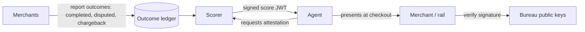

# Architecture — agentrust

## 1. Scope
A portable 300–850 trust score that tells merchants and payment rails whether an agent should be
allowed to spend, plus reason codes and recommended limits.
**MVP:** single-agent scoring from a transaction history (5 factors), bands, adverse-action reasons, limits.
**Product:** a bureau. Merchants report outcomes, agents carry signed score attestations, and merchants query at checkout.

## 2. System context

The diagram below is the product vision (the bureau), not the shipped MVP — the shipped
code scores a single agent's history file locally. The bureau, outcome ledger, signed
attestations, and JWKS verification are Roadmap items.

## 3. Factor model
| Factor | Weight | Computation |
|---|---|---|
| payment history | 35% | `good / (good + 3·bad)`, each event weighted `exp(-age/180d)`; chargeback 1.5×, dispute 1×, failed 0.3× |
| utilization | 30% | trailing-30-day completed spend / authorised budget; ≤10% → 1.0, linear to 0 at 100% |
| history length | 15% | days since first transaction / 365, capped |
| velocity | 10% | last-7-day rate vs. lifetime rate; ratio > 2 decays |
| mix | 10% | distinct counterparties / 8 |

`score = 300 + 550 × Σ wᵢ·fᵢ`. Reason codes are emitted for the two factors with the largest
weighted shortfall that sit below 0.8, the same way FICO adverse-action notices work.

## 4. Design decisions
- **An explainable additive model, not a GBM.** The audience needs adverse-action style reasons,
  and regulators will ask (ECOA analogues). A GBM can come later as a challenger model, with SHAP
  values for reasons.
- **Exponential recency weighting.** An agent that misbehaved a year ago and has been clean since
  should recover.
- **Neutral priors for thin files** (0.5 payment history, 0.7 velocity). New agents land in "Fair",
  not "Poor". The product blends in the *owner's* score.
- `now` is injectable, so scoring is deterministic in tests and backfills.

## 5. Future production architecture (not shipped)
Not shipped: the items below describe the future bureau service, not the current code,
which is a local scorer over a history file with no ingest API, feature store, or attestations.
- Outcome ingest API: merchants POST signed outcome events, deduped by `(merchant, txn_id)`.
- Feature store: per-agent rolling aggregates maintained incrementally, so there are no full rescans.
- Scoring service: stateless, versioned model (`model_version` in every response).
- Attestations: EdDSA-signed JWT `{sub: agent_id, score, band, limits, exp: 24h}`, published via JWKS.

## 6. Security & abuse
- Sybil and "credit washing" through self-dealing transactions: down-weight counterparties that share
  owner or payment instrument, and count mix only across verified merchants.
- Dispute rights: agent owners can contest outcomes, and contested events are excluded pending review.

## 7. SLOs
Targets for the future bureau service, not measurements of the shipped local scorer:
p99 score lookup under 20 ms from cache. Outcome to score update in under 5 min.

## 8. Risks
Cold-start network effects: the bureau has no value without merchant reporting. The wedge is to
integrate with agent-buyer-protection and grantgate, which already see outcomes.
